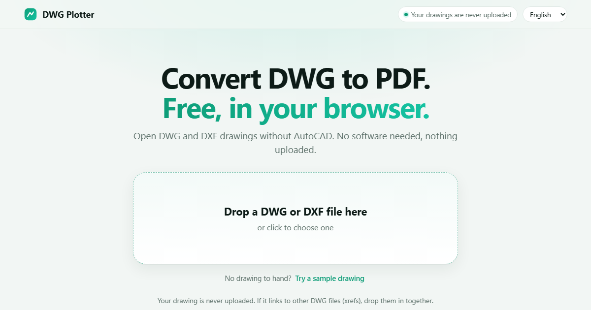

# DWG Plotter

**Free DWG to PDF converter and DWG viewer that runs entirely in your browser. Try it at [dwgplotter.com](https://dwgplotter.com/).**

Open a DWG or DXF drawing without AutoCAD and save it as a PDF. Nothing is uploaded: the drawing is read and plotted on your own device by [LibreDWG](https://www.gnu.org/software/libredwg/) compiled to WebAssembly.

[](https://dwgplotter.com/)

- **Vector PDF**, sharp at any zoom, not a screenshot of the drawing
- Lists every layout (sheet) and the model space, and plots each layout as drawn at its own sheet size
- "Smart plot" finds the real drawings in a cluttered model space and leaves out stray marks
- Black and white with lineweights, or colour; combined or separate files; PDF, PNG or JPG
- Viewer with layer on/off and a measure tool that snaps to line ends and corners
- Linked drawings (xrefs) are used when you supply the matching files
- Reads DWG (AutoCAD R14 to 2018 and newer) and DXF (model space only)
- Works on Windows, Mac, Linux and Chromebook; no install, no account

Guides: [DWG to PDF](https://dwgplotter.com/dwg-to-pdf/) · [DWG viewer](https://dwgplotter.com/dwg-viewer/) · [Open DWG without AutoCAD](https://dwgplotter.com/open-dwg-without-autocad/) · [DWG version checker](https://dwgplotter.com/dwg-version-checker/) · [DWG file won't open](https://dwgplotter.com/dwg-file-wont-open/)

## Run it

It is a static site. Serve this folder with any web server and open `plotter/`:

```
python -m http.server 8765
```

then visit `http://localhost:8765/plotter/`.

## Layout

| Path | What it is |
| --- | --- |
| `plotter/` | The DWG Plotter web app |
| `engine.js` | Reads a drawing, draws it, writes PDF |
| `dxf.js` | DXF reader that feeds the same engine |
| `shx.js`, `pdfctx.js` | SHX font reader and the PDF drawing surface |
| `vendor/` | Third-party libraries (see `NOTICE.md`) |
| `spike.html` | Test page that compares our plots with plots made by AutoCAD |

## Fonts

AutoCAD's SHX fonts are Autodesk's and are **not** included in this repository. Without them, text falls back to the open Hershey single-stroke font. To match AutoCAD lettering more closely when running locally, put the `.shx` files from your own AutoCAD install in `fonts/`.

## Licence

DWG Plotter is free software under the **GNU General Public License v3** (see `LICENSE`), because it includes the GPL-licensed LibreDWG reader. Third-party components and their licences are listed in `NOTICE.md`.

Copyright (C) 2026 Sean Anderton. This program is free software: you can redistribute it and/or modify it under the terms of the GNU General Public License as published by the Free Software Foundation, either version 3 of the License, or (at your option) any later version. It is distributed in the hope that it will be useful, but WITHOUT ANY WARRANTY; without even the implied warranty of MERCHANTABILITY or FITNESS FOR A PARTICULAR PURPOSE. See `LICENSE` for details.

"DWG Plotter" and the dwgplotter.com name are not covered by this licence.
